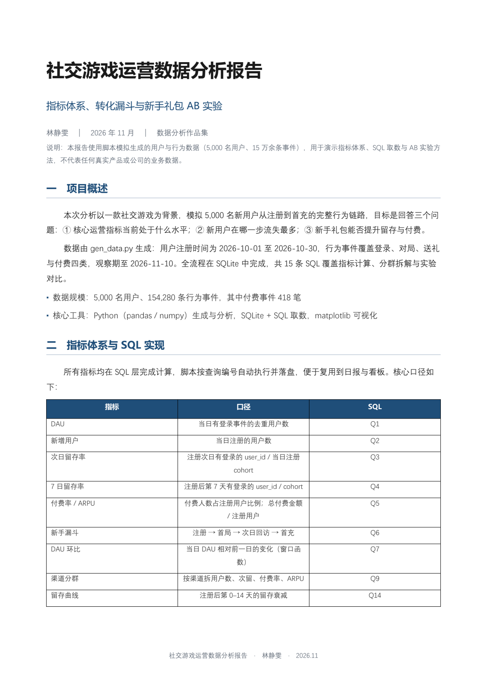
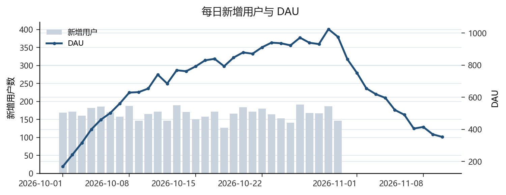
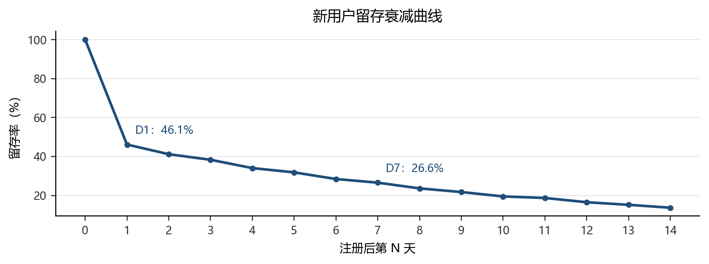
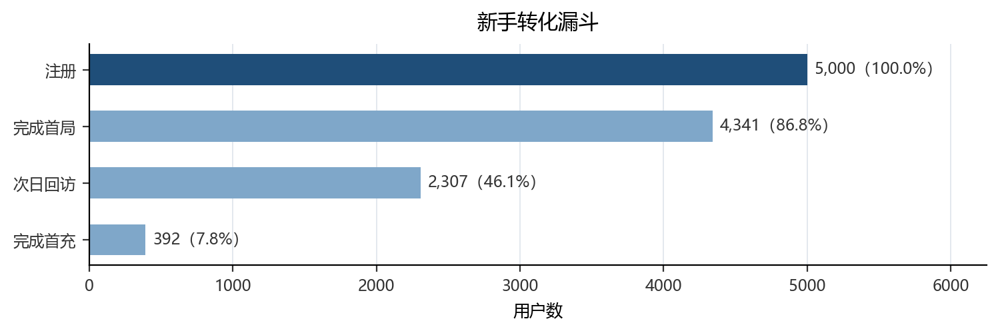
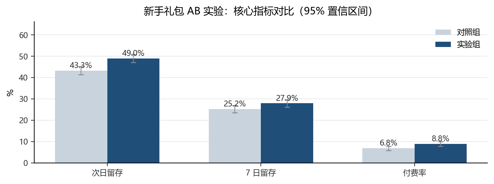

# 社交游戏运营数据分析：SQL 指标体系 + 漏斗 + AB 实验

用 Python 生成模拟埋点数据、SQLite 建库，用 **15 条 SQL** 完成 DAU / 留存 / 付费 / 漏斗 / 渠道分群等指标计算，并设计一次**新手礼包 AB 实验**，输出可视化看板与 4 页分析报告。

> ⚠️ 数据说明：5,000 名用户、154,280 条行为事件均由 `gen_data.py` 模拟生成，仅用于方法演示，不代表任何真实公司或产品的业务数据。

## 项目亮点

- **指标口径全部落在 SQL 里**：15 条查询覆盖 DAU、新增、次日/7 日留存、付费率、ARPU/ARPPU、新手漏斗、DAU 环比（窗口函数）、渠道拆解、新老结构、AB 分组，改表名即可迁移到真实埋点表。
- **一次完整的 AB 实验**：先按基线付费率估算样本量，再做 50/50 随机分组，比例指标用卡方检验、金额指标用 Welch t 检验，给出差异与 95% 置信区间，最后明确「能不能放量」。
- **异动排查有方法论**：以 10-18 新增骤降为例，按「总量 → 渠道拆解 → 时间对比 → 排除法」定位到抖音渠道单日投放异常。

## 结果预览



| 指标 | 数值 | 指标 | 数值 |
|---|---|---|---|
| 次日留存 | 46.2% | 7 日留存 | 26.6% |
| 付费率 | 7.8% | ARPPU | 42.19 元 |
| ARPU | 3.31 元 | DAU 均值 | 681 |
| 首局完成率 | 86.8% | 首充转化率 | 7.8% |

**新手礼包 AB 实验（2,500 人/组）**

| 指标 | 对照组 | 实验组 | 差值 | 95% CI | p 值 |
|---|---|---|---|---|---|
| 次日留存 | 43.28% | 49.00% | +5.72 pp | [2.96, 8.48] | <0.001 |
| 7 日留存 | 25.20% | 27.92% | +2.72 pp | [0.27, 5.17] | 0.029 |
| 付费率 | 6.84% | 8.84% | +2.00 pp | [0.51, 3.49] | 0.008 |
| ARPU | 2.77 | 3.85 | +1.08 | — | 0.011（t 检验） |

## 图表

| DAU 与新增 | 留存衰减 |
|---|---|
|  |  |

| 新手漏斗 | AB 实验 |
|---|---|
|  |  |

## 目录结构

```
social_game_ops/
├─ src/
│  ├─ gen_data.py        生成模拟用户与行为数据
│  ├─ build_db.py        导入 SQLite 并建索引
│  ├─ metrics.sql        15 条指标查询（核心资产）
│  ├─ run_analysis.py    执行 SQL、统计检验、出图、汇总
│  └─ make_report.py     生成 Word / PDF 报告
├─ data/                 生成的 users.csv / events.csv / game.db
├─ output/               图表、results.json、每条 SQL 的结果
├─ images/               README 用图
├─ 社交游戏运营数据分析报告.pdf
└─ README.md
```

## 快速开始

```bash
pip install pandas numpy scipy matplotlib python-docx

python src/gen_data.py      # 1. 生成数据
python src/build_db.py      # 2. 建库
python src/run_analysis.py  # 3. 跑 SQL、检验、出图
python src/make_report.py   # 4. 生成报告（可选）
```

## 指标口径

| 编号 | 指标 | 口径 |
|---|---|---|
| Q1 | DAU | 当日登录去重用户 |
| Q2 | 新增用户 | 当日注册 |
| Q3 / Q4 | 次日 / 7 日留存 | 注册后第 1 / 7 天有登录的 cohort 占比 |
| Q5 | 付费率 / ARPU / ARPPU | 付费人数、总金额/注册用户、总金额/付费人数 |
| Q6 | 新手漏斗 | 注册 → 首局 → 次日回访 → 首充 |
| Q7 | DAU 环比 | 窗口函数 `LAG` |
| Q8 | 渠道拆解 | 异动日按渠道拆分新增 |
| Q9 | 渠道分群 | 各渠道次留、付费率、ARPU |
| Q10 | 新老结构 | 按注册日区分新老用户 DAU |
| Q11–Q13 | AB 与行为指标 | 分组留存、付费、人均对局与送礼 |
| Q14 | 留存曲线 | 注册后 0–14 天衰减 |
| Q15 | 用户付费金额 | 供 t 检验使用 |

## 方法说明

**为什么先算样本量**：基线付费率约 8%，要检出 +2 pp 的提升（α=0.05、power=0.8），每组约需 3,211 人。本次每组 2,500 人，对大指标足够，但分层到单渠道就偏少——这一点写进了报告的局限里。

**为什么比例用卡方、金额用 t 检验**：留存率、付费率是二项分布的比例指标，用两比例 z 检验（等价于 2×2 卡方）；ARPU 是连续金额且长尾，用 Welch t 检验避免方差齐性假设。

**异动排查顺序**：先看总量（新增跌幅 vs DAU 跌幅），再拆维度（渠道/设备/版本），再做时间对比（次日是否恢复），最后用排除法定位到投放侧，而不是产品侧。

## 可复用点

- `metrics.sql` 改写成 MySQL / Hive 语法、替换表名，即可用于真实埋点数据
- `run_analysis.py` 里的 `prop_test`、`chi2_contingency`、样本量估算可以直接复用到其他 AB 实验
- `make_report.py` 可以替换成任意模板，用于周报/月报自动生成

## 作者

林静雯 · 中南财经政法大学 数字经济硕士在读 · 2026.11
